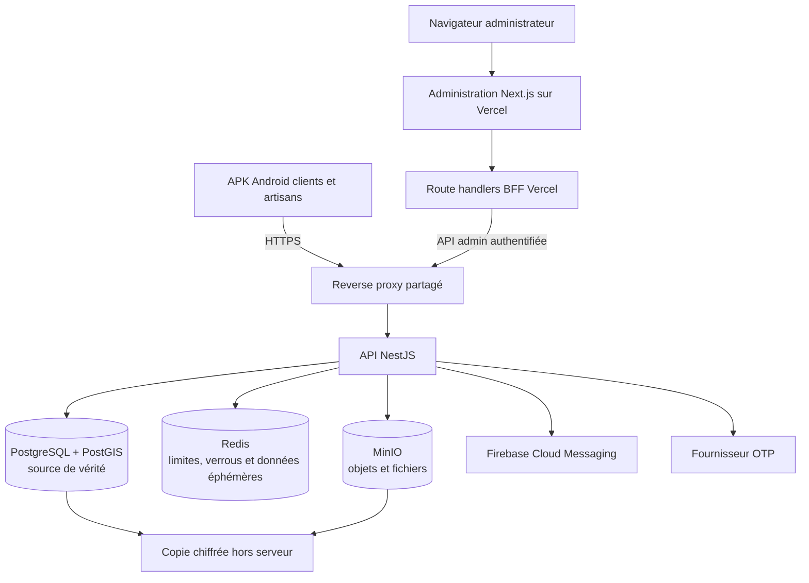

# Protocole impératif de rénovation de Fiers Artisans

## Autorité et périmètre

Ce fichier est l'autorité opérationnelle principale pour tout agent IA travaillant
dans ce dépôt. Il s'applique au backend, à l'application Flutter, à
l'administration web, aux données et à l'infrastructure.

En cas de contradiction avec `SECURITY_ARCHITECTURE.md` ou une ancienne
documentation interne, le présent fichier prévaut pour la rénovation. Les règles
de sécurité, de préservation des données et de vérification restent applicables.
Pour une session ChatGPT connectée au dépôt par MCP, appliquer aussi le mode
opératoire de `codex-chat.md`, sans en faire une autorité contraire au présent
protocole.

## Mission non négociable

Rénover ce monorepo dans cet ordre :

1. préserver les données, les contrats encore consommés et l'UX active ;
2. supprimer les fonctionnalités abandonnées ou absentes de l'UI ;
3. réduire l'infrastructure et les services persistants ;
4. réduire le nombre de dossiers, fichiers, couches et abstractions ;
5. simplifier les algorithmes et la logique métier ;
6. centraliser le code restant par application et par domaine ;
7. franciser tout le code appartenant au projet ;
8. supprimer les dépendances devenues inutiles ;
9. prouver le fonctionnement par des tests et contrôles réels.

Une étape ne peut pas être contournée pour commencer une étape suivante plus
visible ou plus agréable.

## Architecture cible du monorepo

La cible est un seul dépôt, avec des environnements clairement séparés :

```text
applications/
  mobile/
  administration/
services/
  api/
infrastructure/
  commun/
  developpement/
  staging/
  production/
  vercel/
outils/
```

Cette arborescence est une cible de migration, pas une autorisation de tout
déplacer en une seule opération. Chaque déplacement doit préserver les builds,
les chemins Docker, les assets Flutter et les déploiements.

Chaque environnement contient seulement ses différences. Les éléments communs
ne doivent pas être copiés dans plusieurs dossiers.

## Schéma de l'architecture cible



MongoDB est supprimé après migration et vérification. Le chat et ses WebSockets,
les paiements, abonnements et Wave, Grafana et Prometheus ne font pas partie de
la cible. Aucun worker résident n'est maintenu sans charge durable démontrée.

## Règle de centralisation

Le projet privilégie explicitement de grands fichiers cohérents plutôt qu'une
dispersion en nombreux petits fichiers.

- Centraliser par application et par domaine métier, jamais toutes les
  applications dans un même fichier.
- Un domaine backend vise un fichier principal lisible regroupant, lorsque le
  framework le permet, contrôleur, service, DTO, types et règles métier.
- Un grand fichier peut contenir plusieurs milliers de lignes s'il représente
  un seul domaine et possède un sommaire de sections clair.
- Garder séparés uniquement les fichiers imposés par un framework, les
  migrations, les tests, les secrets, les configurations d'environnement et les
  artefacts ayant un cycle de déploiement distinct.
- Ne pas créer un fichier, une interface, une factory, un repository, un helper
  ou un dossier pour une seule utilisation triviale.
- Ne pas déplacer une fonction simple dans un helper générique. La garder près
  du parcours qui l'utilise.
- Ne pas utiliser un index `barrel` si l'import direct est plus clair.
- Ne pas conserver de code supprimé sous forme commentée, de dossier `legacy`,
  de doublon ou d'archive source. Git constitue l'historique.

Tout fichier centralisé de plus de 500 lignes doit avoir des séparateurs de
sections explicites dans cet ordre lorsque pertinent : types, constantes,
validation, lecture, écriture, règles métier, adaptation externe, utilitaires.

## Règle de simplicité pour développeurs juniors

Le code doit favoriser un chemin de lecture linéaire et explicite.

- Noms métier complets, sans abréviation ambiguë.
- Retours anticipés pour les erreurs et cas limites.
- Trois niveaux d'imbrication au maximum dans le code métier ; extraire une
  fonction locale nommée si ce seuil est dépassé.
- Une fonction réalise une intention métier identifiable, même si elle reste
  dans un grand fichier centralisé.
- Préférer les boucles, conditions et objets explicites aux générateurs,
  métaprogrammations, décorateurs internes, récursions et génériques complexes.
- Supprimer les calculs répétés, conversions successives, tris doubles,
  requêtes en boucle et recomputations d'une valeur stable.
- Aucun cache, parallélisme, traitement différé ou algorithme sophistiqué sans
  mesure ou contrainte réelle qui le justifie.
- Les invariants de paiement, authentification, vérification et abonnement sont
  expliqués en français immédiatement avant leur mise en œuvre.
- Les erreurs ne sont jamais avalées silencieusement. Elles sont retournées,
  journalisées de manière exploitable ou explicitement classées non bloquantes.

La réduction du nombre de lignes n'est pas une fin en soi. La réduction du
nombre de concepts, de branches, d'états et de chemins d'exécution est prioritaire.

## Francisation obligatoire

Tout élément appartenant au projet doit progressivement être écrit en français :

- noms de fichiers et dossiers non imposés par un outil ;
- variables, fonctions, classes, types, enums et constantes internes ;
- commentaires, journaux, erreurs, documentation et tests ;
- noms des règles métier et des événements internes ;
- commandes et scripts propres au projet lorsque leur convention le permet.

Ne doivent pas être traduits artificiellement :

- mots-clés TypeScript, Dart, SQL, YAML et shell ;
- noms exportés par NestJS, Flutter, Next.js ou une dépendance ;
- méthodes standards HTTP et noms de protocoles ;
- fichiers dont le nom est imposé par un framework ;
- contrats externes existants encore utilisés par une APK, Vercel, un webhook,
  une base ou un fournisseur.

Un ancien contrat anglais ne justifie pas de conserver l'anglais en interne.
Créer un adaptateur à la frontière, utiliser le français dans le domaine, puis
migrer le contrat par compatibilité ascendante. Ne jamais renommer brutalement
une route, une colonne, un champ JSON ou une variable d'environnement consommée.

## Suppression des fonctionnalités inutiles

La présence de code ne prouve pas qu'une fonctionnalité doit être conservée.

Avant de conserver une fonctionnalité backend, trouver au moins un consommateur
réel parmi : UI mobile active, UI admin active, intégration externe active,
exigence de sécurité, opération d'exploitation ou obligation métier documentée.

Si aucun consommateur réel n'existe :

1. vérifier les routes, imports, navigation, configurations et journaux ;
2. vérifier qu'aucune ancienne APK supportée ne la consomme ;
3. ajouter si nécessaire une période de dépréciation ou un drapeau distant ;
4. sauvegarder les données concernées ;
5. supprimer verticalement UI, état, client API, route, service, stockage,
   dépendance, configuration et documentation ;
6. vérifier qu'aucun symbole, endpoint ou état mort ne subsiste.

Fonctionnalités dont le retrait est déjà décidé, sous réserve de migration sans
rupture : chat interne, WebSocket associé, paiement manuel, abonnement payant,
intégration Wave, preuves de paiement, visibilité conditionnée par un paiement,
Grafana et Prometheus.

## Gratuité du produit

Fiers Artisans est une application gratuite pour les clients et les artisans.

- Aucun paiement, abonnement payant, période d'essai payante, preuve de paiement,
  remboursement ou fournisseur de paiement ne doit subsister dans le produit.
- L'inscription suffit pour accéder au produit selon le rôle et les règles de
  vérification du compte.
- La visibilité d'un artisan ne dépend jamais d'un paiement ou d'un abonnement.
- Les seuls critères de visibilité autorisés sont l'état actif du compte, la
  vérification requise, la disponibilité déclarée et la qualité minimale du
  profil lorsqu'elle est définie par le produit.
- Les anciennes routes et données de paiement suivent une dépréciation, une
  sauvegarde puis une suppression contrôlée. Elles ne doivent pas être remplacées
  par une nouvelle forme de monétisation sans décision humaine explicite.

Ne pas confondre fonctionnalité sans écran et fonction indispensable. Les
webhooks, healthchecks, migrations, sauvegardes, tâches de rétention et contrôles
de sécurité peuvent être nécessaires sans UI.

## Compatibilité mobile et UX

Une APK publiée ne peut pas être corrigée instantanément. Toute suppression de
contrat mobile suit obligatoirement la séquence :

1. capacité ou drapeau distant ;
2. nouvelle APK qui n'utilise plus le contrat ;
3. déploiement progressif ;
4. mesure de l'adoption ;
5. version minimale supportée si nécessaire ;
6. retrait backend seulement lorsque les anciennes versions ne sont plus
   supportées.

Les routes et payloads existants restent compatibles pendant cette fenêtre. Une
simplification interne ne doit pas modifier les textes, statuts, chargements,
erreurs ou résultats visibles sans décision produit explicite.

## Données et transactions

- PostgreSQL devient la source de vérité principale.
- Redis reste réservé aux données éphémères, verrous et limitations de débit.
- MinIO reste réservé aux objets binaires.
- MongoDB doit disparaître après migration et vérification des données utiles.
- Une donnée possède un seul propriétaire logique.
- Une opération métier critique utilise une transaction unique lorsque ses
  écritures sont dans PostgreSQL.
- Une conséquence asynchrone utilise une outbox durable ; ne pas utiliser
  `setImmediate` ou un `catch` vide comme garantie de livraison.
- Après le retrait du chat et des paiements, ne pas maintenir un worker résident
  sans charge durable démontrée. Les purges, sauvegardes et consommations légères
  peuvent être exécutées par des commandes ponctuelles planifiées par `systemd`.
- Toute migration suit le modèle expansion, double compatibilité, bascule,
  contraction. Aucune suppression de colonne ou de collection dans la même
  livraison que son remplacement initial.

## Dépendances

Chaque dépendance directe doit avoir une justification observable.

Avant suppression, vérifier :

- imports du code et des tests ;
- fichiers de configuration ;
- build runners et génération ;
- plugins Android, Flutter, Next.js et NestJS ;
- scripts de build et de déploiement ;
- usages natifs non visibles par un import direct.

Après suppression, régénérer le lockfile avec l'outil officiel puis exécuter le
build et les tests. Ne jamais conserver une dépendance « au cas où ».

## Infrastructure et environnements

- Docker Compose est l'orchestrateur de référence tant qu'il n'existe qu'un
  serveur physique.
- Chaque projet possède son nom Compose, son réseau interne, ses volumes, ses
  secrets, ses limites CPU/RAM et ses sauvegardes.
- Seul le reverse proxy partagé publie les ports 80 et 443.
- PostgreSQL, Redis et MinIO ne publient aucun port en production.
- L'administration Vercel ne se connecte jamais directement à une base.
- Les previews Vercel utilisent staging, jamais les données de production.
- Les secrets ne sont jamais versionnés, ajoutés à un commit ou une pull request,
  imprimés dans un terminal ou des logs, ni copiés dans un rapport IA. Utiliser
  des exemples factices ; si un secret est exposé, demander sa révocation ou son
  renouvellement.
- Un agent distant ou MCP exécute migrations et tests uniquement dans un
  environnement isolé et jetable, avec des données fictives et des intégrations
  externes simulées. Il n'utilise aucun secret, volume ou service de production.
- Aucun push, publication de pull request ou déploiement de production avant que
  l'utilisateur ait confirmé ses tests locaux et demandé explicitement l'action.
- Les logs ont une rotation et une limite de taille.
- Kubernetes et Swarm sont interdits sur le serveur unique sans nouvelle
  décision humaine motivée par l'ajout réel de plusieurs nœuds.

## Ordre obligatoire de chaque lot de rénovation

1. Décrire le comportement utilisateur à préserver.
2. Recenser producteurs, consommateurs, données et contrats.
3. Identifier le code réellement exécuté et le code mort.
4. Écrire ou renforcer les tests de caractérisation du comportement conservé.
5. Supprimer verticalement la fonctionnalité abandonnée.
6. Simplifier les données et l'algorithme restant.
7. Centraliser les fichiers du domaine.
8. Franciser les éléments internes.
9. Supprimer les dépendances et configurations orphelines.
10. Exécuter tests, builds, analyse statique et contrôle des contrats.
11. Comparer le nombre de services, dossiers, fichiers, dépendances, lignes et
    branches avant/après.

Ne pas mélanger deux domaines métier indépendants dans un même lot. Un lot peut
toucher plus de cinq fichiers si la suppression verticale ou un déplacement
mécanique l'exige, mais il conserve une seule intention et doit être validé dans
son ensemble.

## Preuves exigées avant suppression

Une recherche textuelle seule ne suffit pas. Fournir au minimum :

- recherche des imports et références ;
- recherche des routes et consommateurs ;
- vérification de la navigation UI ;
- vérification des configurations et scripts ;
- résultat des tests de caractérisation ;
- état des données à conserver ;
- plan de retour arrière.

Toute destruction de données, migration irréversible, retrait de route encore
consommée ou changement de topologie de production exige une validation humaine
explicite au point d'exécution.

## Validation minimale

Selon le périmètre, exécuter réellement :

```text
backend      : tests, build, lint sans correction automatique
mobile       : flutter analyze, flutter test, build APK de validation
administration: lint, build, tests des parcours critiques
infrastructure: docker compose config, healthchecks et test de restauration
contrats     : synchronisation backend/mobile/admin et compatibilité ancienne APK
```

Si un outil ou une dépendance manque, le signaler comme non vérifié. Ne jamais
présenter un contrôle non exécuté comme réussi.

## Rapport de lot obligatoire

Chaque lot se termine par :

- comportement conservé ;
- fonctionnalité et code supprimés ;
- fichiers fusionnés, créés et supprimés ;
- dépendances retirées ;
- services et ressources économisés ;
- contrats temporaires encore maintenus ;
- tests exécutés et résultats ;
- risques résiduels ;
- prochaine étape unique.

Le rapport doit inclure les mesures avant/après disponibles. Il est interdit de
conclure seulement par « terminé » ou « cela fonctionne ».
