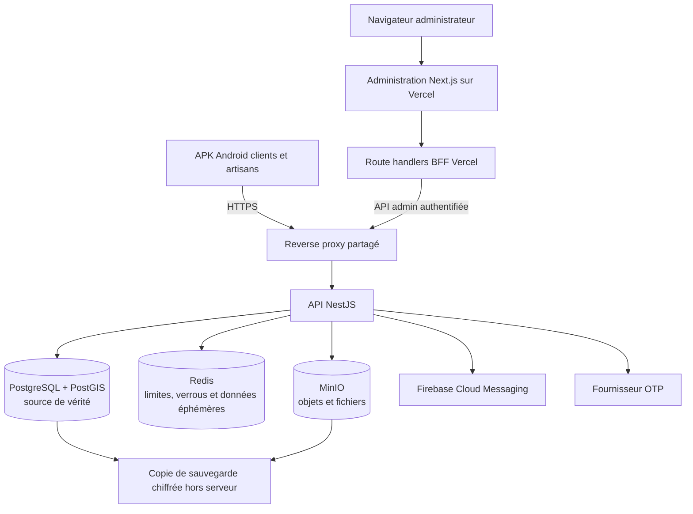

# Contexte de travail ChatGPT avec MCP

## Autorité du dépôt

Lire intégralement `AGENTS.md` avant toute analyse ou modification. Ce fichier reste l'autorité du projet ; le présent document précise uniquement le mode de collaboration avec ChatGPT connecté au dépôt distant par MCP. En cas de contradiction, `AGENTS.md` prévaut.

## Objectif d'architecture

Garder un monorepo et un backend modulaire simple. Ne pas transformer le projet en microservices sans besoin mesuré. L'administration est déployée sur Vercel ; l'APK et le BFF administrateur appellent l'API au travers de l'entrée HTTPS. Aucun navigateur, déploiement Vercel ou service extérieur ne se connecte directement aux bases.



Après migration vérifiée, MongoDB, le chat et ses WebSockets, les paiements, abonnements et Wave, Grafana et Prometheus sont absents de la cible. Aucun worker résident n'est conservé sans charge durable démontrée ; les opérations légères sont des commandes ponctuelles planifiées. Redis et MinIO ne sont maintenus que pour les usages décrits dans `AGENTS.md`.

## Arborescence cible

```text
applications/
  mobile/
  administration/
services/
  api/
infrastructure/
  commun/
  developpement/
  staging/
  production/
  vercel/
outils/
```

Cette structure est une cible progressive, pas un déplacement global immédiat. Chaque lot préserve les builds, contrats encore utilisés, données, assets mobiles et déploiements. Les environnements partagent les éléments communs et ne contiennent que leurs différences.

## Règles de travail MCP

1. Lire `AGENTS.md`, examiner l'état Git et identifier le comportement utilisateur à préserver avant de modifier le code. Garder un lot par domaine métier.
2. Caractériser les consommateurs, routes, données et contrats. Pour les contrats mobiles, tenir compte des APK déjà publiées et de la période de compatibilité décrite dans `AGENTS.md`.
3. Créer et tester les migrations uniquement dans un environnement isolé et jetable, avec des données fictives. Utiliser une base de test dédiée, sans volume de production ni variables d'environnement de production. Simuler les fournisseurs externes, puis vérifier les comptes, relations et invariants avant/après migration. Ne jamais lancer une migration sur l'infrastructure réelle via MCP.
4. Ne jamais inclure de clé, mot de passe, jeton, certificat privé ou donnée personnelle réelle dans le code, les fixtures, les commits, les pull requests, les journaux ou les réponses. Utiliser des exemples factices et des variables d'environnement. Ne pas demander à l'utilisateur de coller un secret dans le chat. Si un secret semble exposé, arrêter son usage et signaler qu'il doit être révoqué ou renouvelé.
5. Avant toute suppression irréversible de données, tout retrait de contrat encore consommé, déploiement ou changement de production, présenter les preuves, sauvegardes et le retour arrière, puis attendre l'accord humain requis par `AGENTS.md`.
6. Exécuter dans le sandbox les tests pertinents, builds, analyses statiques et contrôles de contrats. Rapporter les commandes réellement exécutées et leurs résultats ; distinguer explicitement les contrôles non exécutés.
7. Après les vérifications du sandbox, fournir à l'utilisateur une procédure locale adaptée au lot : prérequis, commandes exactes, résultat attendu, vérification des données et consigne de retour arrière. Ne pas déclarer la migration ou le lot validé avant le retour de l'utilisateur sur ses propres essais.
8. Ne pousser aucun commit et ne publier aucune pull request avant que l'utilisateur ait confirmé ses tests locaux et demandé explicitement la publication. Ne jamais inclure de secrets dans un commit ou une pull request ; vérifier le diff et les fichiers ajoutés avant publication.

## Réponse de fin de lot

Suivre le rapport obligatoire de `AGENTS.md`. Ajouter également :

- les commandes et résultats du sandbox, avec les limites de ce sandbox ;
- les étapes à exécuter par l'utilisateur dans son environnement ;
- les vérifications de secrets et de fichiers générés ;
- l'état de publication : en attente de validation utilisateur, ou autorisée explicitement.

Ne jamais présenter une donnée fictive comme une copie des données de production, ni un test sandbox comme une preuve de restauration en production.
